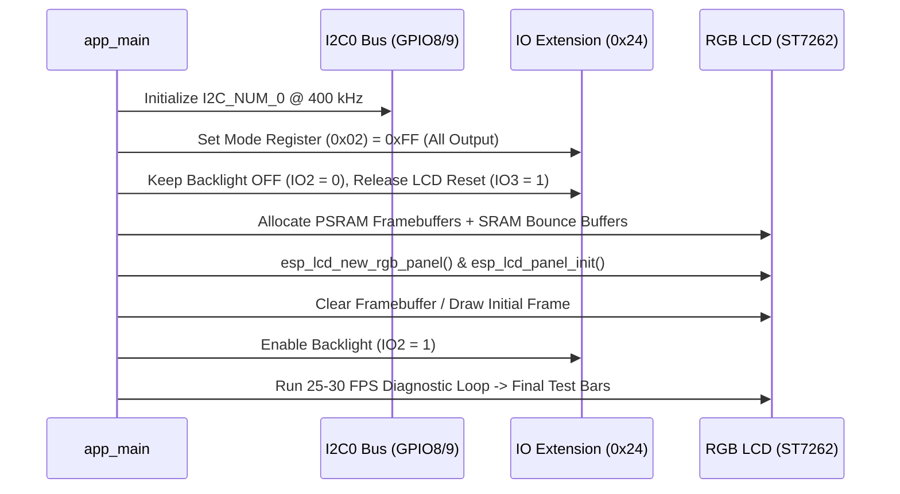

# System & Display Architecture

## 1. Architectural Goals

1. **Reliable Hardware Bring-Up**: Deterministic initialization order for I2C, IO Extension (`0x24`), Octal PSRAM, and the ST7262 RGB565 LCD panel.
2. **Sustained 25–30 FPS Rendering**: Smooth full-screen updates at `1024 × 600` (16-bit RGB565) with zero horizontal shift ("screen drift") or tearing.
3. **Clean BSP Separation**: Isolate board-level hardware details (pins, I2C registers, panel handles) inside modular components so application logic remains hardware-agnostic.

---

## 2. Initialization Sequence



---

## 3. Memory & Display Pipeline (`1024 × 600` RGB565)

Each `1024 × 600` RGB565 frame is **1,228,800 bytes (~1.17 MiB)**. Because ESP32-S3 has 512 KB of internal SRAM, full framebuffers **must** reside in the **8 MB Octal PSRAM**.

### 3.1 Avoiding PSRAM Bandwidth Starvation ("Screen Drift")

When the CPU writes new pixel data to PSRAM while the LCD GDMA controller simultaneously reads PSRAM to feed the RGB panel at `24–30 MHz` pixel clock, PSRAM bus contention can cause DMA underruns (manifesting as horizontal image shift).

We mitigate this using four architectural mechanisms:

1. **Octal PSRAM @ 80 MHz DDR**: Provides ~80 MB/s raw bus bandwidth.
2. **SRAM Bounce Buffers (`bounce_buffer_size_px = 1024 * 20`)**:
   - The `esp_lcd` RGB driver allocates two small bounce buffers (40 KB each) in fast **Internal SRAM**.
   - GDMA feeds the LCD peripheral directly from internal SRAM, while background cache/DMA bursts refill the bounce buffers from PSRAM.
3. **XIP from PSRAM (`CONFIG_SPIRAM_FETCH_INSTRUCTIONS=y`, `CONFIG_SPIRAM_RODATA=y`) & IRAM Safe ISR (`CONFIG_ESP_LCD_RGB_ISR_IRAM_SAFE=y`)**:
   - Keeps LCD interrupt handlers running even during SPI Flash operations.
   - Enables `CONFIG_ESP_LCD_RGB_RESTART_IN_VSYNC=y` to automatically recover DMA alignment on VSYNC if a transient stall ever occurs.
4. **Tuned Pixel Clock (`26 MHz` – `30 MHz`) & Direct Framebuffer Access**:
   - Using `pclk_hz = 26000000` (26 MHz) yields a native hardware refresh rate of **~28.4 Hz**, right in the center of the **25–30 FPS** target window, while leaving generous PSRAM write bandwidth for CPU rendering.
   - Drawing directly into the PSRAM framebuffer pointer returned by `esp_lcd_rgb_panel_get_frame_buffer()` (followed by cache writeback or `esp_lcd_panel_draw_bitmap()`) minimizes redundant memory copies.

---

## 4. Planned Component Architecture

```text
components/
└── bsp_waveshare_7b/
    ├── CMakeLists.txt
    ├── include/
    │   ├── bsp_waveshare_7b.h     # Public BSP API (init, backlight, framebuffer access)
    │   └── bsp_io_extension.h     # IO Extension (0x24) register & pin API
    ├── bsp_io_extension.c         # I2C0 master + 0x24 GPIO/PWM/ADC driver
    └── bsp_rgb_lcd.c              # ST7262 RGB565 panel init, VSYNC sync & drawing helpers
```
